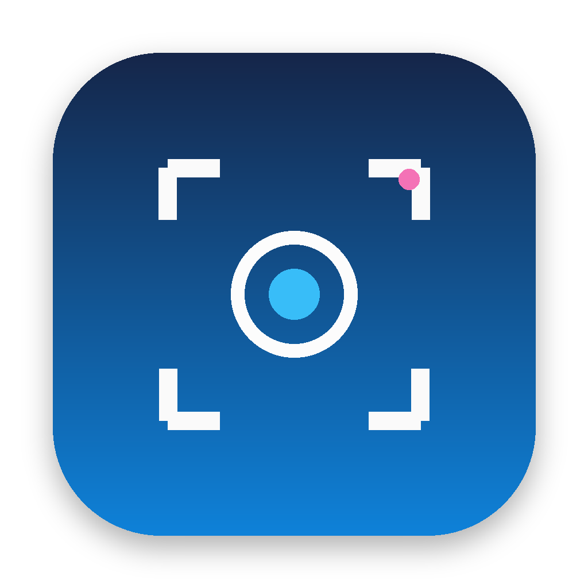

# Just Screenshot

<p align="center">
  
</p>

Легковесное, быстрое и современное приложение для создания скриншотов, записи экрана и аннотирования для macOS (macOS 14 Sonoma и новее).

---

## Возможности

- **Захват области**: Свободный выбор прямоугольной области с отображением размеров в реальном времени.
- **Скриншот окна**: Умная детекция и захват любого открытого окна с сохранением аккуратных границ.
- **Запись видео**: Запись выбранной области экрана со звуком через нативный ScreenCaptureKit и кодирование в MP4 (H.264).
- **Плавающий HUD**: Мгновенный доступ к только что сделанному снимку (копирование, сохранение, открытие редактора, пин на экране, распознавание текста).
- **Полнофункциональный редактор**:
  - Стрелки, прямоугольники, скругленные рамки, овалы
  - Текст с настройкой размера и цвета
  - Пошаговые нумерованные маркеры (счетчик 1-2-3)
  - Цензурирование (размытие / Blur)
  - Выделение маркером (Highlighter)
  - История отмены и повтора (Undo / Redo)
- **Распознавание текста (OCR)**: Нативное распознавание текста на снимках через Apple Vision framework.
- **Закрепление на экране (Pin to Screen)**: Плавающие поверх всех окон заметки со снимком с настройкой прозрачности.
- **История снимков**: Локальная галерея миниатюр с быстрым поиском, открытием в Finder и повторным редактированием.
- **Автозапуск при входе в систему**: Нативная интеграция через `SMAppService` (включается через меню).
- **Строка меню (Menu Bar Extra)**: Работа в фоне без лишних окон в Dock.

---

## Горячие клавиши

| Комбинация | Действие |
|---|---|
| `⌘ + ⇧ + 4` | Скриншот окна |
| `⌘ + ⇧ + 5` | Скриншот произвольной области |
| `⌘ + ⇧ + 3` | Запись экрана |
| `⌘ + ⇧ + H` | История снимков |

---

## Требования

- macOS 14.0 (Sonoma) или новее
- Swift 6.0+ / Xcode 15+

---

## Сборка и запуск

Сборка готового приложения `.app`:

```bash
chmod +x build_app.sh
./build_app.sh
```

После завершения скрипт создаст подписанный бандл `Just Screenshot.app`, готовый к запуску.
