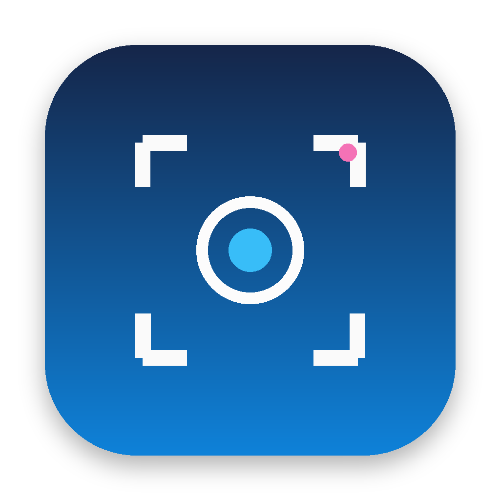

# Just Screenshot

<p align="center">
  
</p>

<p align="center">
  <strong>A modern, blazingly fast, and lightweight screen capture, recording, and annotation suite engineered natively for macOS.</strong>
</p>

<p align="center">
  <a href="https://github.com/banzaez/just-screenshot/releases"></a>
  
  
  
  
</p>

---

## Overview

**Just Screenshot** is an all-in-one macOS utility designed for developers, designers, and creators who need high-precision captures, rich annotations, seamless screen recordings, and instant on-device optical character recognition (OCR)—all wrapped in an elegant, unobtrusive native macOS interface.

Built from the ground up using **Swift 6**, **SwiftUI**, and **AppKit**, Just Screenshot integrates deeply with Apple's modern graphics and system frameworks—including **ScreenCaptureKit** for hardware-accelerated 60 FPS recording and **Apple Vision** for 100% private on-device text recognition.

---

## Key Features

### 📸 Precision Capture
- **Interactive Area Capture**: Freeform rectangular selection with real-time dimensions, pixel coordinate tracking, and Retina resolution fidelity.
- **Smart Window Detection**: Hover-to-detect individual application windows and capture them with crisp borders and natural drop shadows.
- **Repeat Last Capture**: Instantly snap the exact same screen coordinates again without re-selecting.
- **Multi-Display Aware**: Seamless capture across mixed-DPI multi-monitor setups.

### 🎥 High-Performance Screen Recording
- **ScreenCaptureKit Engine**: Low-CPU, low-latency 60 FPS screen recording powered by Apple's latest screen capture pipeline.
- **Live Recording HUD & Overlays**:
  - Floating recording control bar (pause, stop, discard, elapsed timer).
  - Keystroke visualization (displays pressed hotkeys and key combos in real-time).
  - Cursor highlights and click ripple animations.
  - Frame bounds overlay with dimmed background outside the active recording area.
  - Optional pre-recording countdown (3s / 5s / instant).
- **Audio Capture**: Record system audio and external microphone input concurrently.
- **Multi-Format Export**: Export recordings to **MP4 (H.264)**, **animated GIF**, or **animated WebP** (powered by native `libwebp`).
- **Integrated Video Editor**: In-app timeline trimmer, crop controls, and video annotation burn-in.

### ⚡ Floating Quick-Action HUD
- Appears instantly next to your capture for rapid workflow continuation:
  - **Copy**: Push image directly to system clipboard.
  - **Save**: Save to default or custom directory with automated naming.
  - **Edit**: Launch directly into the full annotation suite.
  - **Pin**: Float the screenshot on top of all windows for reference.
  - **OCR**: Extract text from image in one click.
- Multi-capture stacking support for rapid batch workflows.

### ✏️ Annotation & Graphic Studio
- **Shapes & Drawing**: Precise arrows, rectangles, rounded cards, ovals, and freehand highlighters.
- **Step Counters**: Numbered milestone badges (`1`, `2`, `3`...) that automatically increment—perfect for bug reports and tutorials.
- **Text Callouts**: Rich typography controls with size, color, weight, and background padding.
- **Privacy Censoring**: Pixel-perfect blur and redaction tools to conceal sensitive information, passwords, and tokens.
- **Presentation Backdrops**: Modern gradient backdrops, customizable canvas padding, and drop shadows (Liquid Glass aesthetic) optimized for sharing.
- **Full History**: Unlimited undo/redo stack and fast keyboard navigation.

### 🔍 Native On-Device OCR
- Fast and secure text extraction leveraging Apple's **Vision Framework**.
- Extract text from unselectable text areas, terminal logs, code snippets, or images directly to your clipboard.
- Zero network requests: 100% private and offline.

### 📌 Pin to Screen (Reference Cards)
- Float any screenshot on top of other applications as an always-on-top window.
- Adjustable opacity and draggable placement for comparing UI designs, tracking specs, or following documentation.

### 🗂️ Capture History & Library
- Visual thumbnail gallery of all past screenshots and screen recordings.
- Searchable filter, quick reveal in Finder, re-edit capabilities, and quick export.

### ⚙️ Native System Integration & Privacy
- **Menu Bar Utility**: Runs quietly in the background without cluttering the Dock (`LSUIElement`).
- **Global Customizable Hotkeys**: Register both primary and secondary global hotkey combinations for all core actions.
- **Launch at Login**: Native startup management using Apple `SMAppService`.
- **Automatic Updates**: Secure auto-updates signed with Ed25519 cryptographic keys powered by **Sparkle 2**.
- **Multilingual Support**: Fully localized in English, German, French, Spanish, Japanese, Simplified Chinese, Ukrainian, and Russian.
- **Zero Telemetry**: No trackers, no analytics, no external servers.

---

## Default Keyboard Shortcuts

| Action | Primary Shortcut | Alternative / Configurable |
|:---|:---:|:---:|
| **Area Capture** | `⌘ + ⇧ + 5` | Custom in Settings |
| **Window Capture** | `⌘ + ⇧ + 4` | Custom in Settings |
| **Screen Recording** | `⌘ + ⇧ + 3` | Custom in Settings |
| **Repeat Last Capture** | `⌘ + ⌥ + 5` | Custom in Settings |
| **Text Capture (OCR)** | `⌘ + ⌥ + 6` | Custom in Settings |
| **Capture History** | `⌘ + ⇧ + H` | Custom in Settings |

> All shortcuts can be customized or paired with secondary keys in **Settings → Hotkeys**.

---

## Tech Stack & Architecture

- **Language**: Swift 6 (Strict concurrency checks enabled)
- **UI Frameworks**: SwiftUI & AppKit (hybrid architecture for optimal macOS integration)
- **Capture & Video**:
  - `ScreenCaptureKit` for high-performance screen streaming and capture
  - `AVFoundation` for audio/video muxing, encoding, and hardware acceleration
  - `webp.swift` / `libwebp` for animated WebP compilation
- **Intelligence**: `Vision` framework for on-device OCR
- **System Integration**: `SMAppService` (Login Items), `Carbon.HIToolbox` (Global Hotkeys)
- **Packaging & Updates**: Sparkle 2 framework (Ed25519 signature validation)

---

## Requirements

- **Operating System**: macOS 14.0 (Sonoma) or newer (macOS 15 Sequoia compatible)
- **Hardware**: Apple Silicon (M1/M2/M3/M4) or Intel Mac (Universal Binary)
- **Build Tools**: Xcode 15.0+ or Swift 6.0+ toolchain

---

## Building & Development

The repository includes a unified developer control center via **`manage.sh`** and **`Makefile`**:

### Interactive Developer Menu
```bash
./manage.sh
# or
make menu
```

### Quick Commands

```bash
# Build & run locally in debug/release mode
make run
# or: ./manage.sh run

# Compile the standalone macOS App Bundle ("Just Screenshot.app")
make build
# or: ./manage.sh build

# Execute Swift unit tests
make test
# or: ./manage.sh test

# Verify signing certificates and Sparkle keys
make status
# or: ./manage.sh status

# Run automated release pipeline (Build, Sparkle DMG/ZIP signing & Appcast generation)
make release
# or: ./manage.sh release
```

Low-level build and release automation scripts are organized in the `scripts/` directory.

---

## Project Structure

```text
just-screenshot/
├── Sources/
│   └── JustScreenshotApp/
│       ├── Capture/          # ScreenCaptureKit wrappers & screen samplers
│       ├── Core/             # App settings, window manager, hotkeys, OCR, localization
│       ├── Recording/        # Video exporters (MP4, GIF, WebP), cursor tracking
│       ├── UI/               # SwiftUI & AppKit interfaces
│       │   ├── Editor/       # Annotation studio, canvas, drawing tools
│       │   ├── History/      # Thumbnail gallery and history management
│       │   ├── HUD/          # Floating quick-action cards
│       │   ├── Overlay/      # Selection area window, countdown overlays
│       │   ├── Pin/          # Always-on-top pinned window views
│       │   ├── Recording/    # Live recording frame, HUD, and video trimmer
│       │   └── Settings/     # Liquid Glass preferences window & tabs
│       └── Resources/        # AppIcon assets and branding
├── Tests/                    # Swift unit tests
├── scripts/                  # Build, packaging, and Sparkle release automation
├── manage.sh                 # Terminal developer control center
├── Makefile                  # Make command shortcuts
└── Package.swift             # Swift Package Manager manifest
```

---

## Contributing

Contributions, issues, and feature requests are welcome! Feel free to check the [issues page](https://github.com/banzaez/just-screenshot/issues) if you want to contribute.

---

## License

This project is licensed under the [MIT License](LICENSE) (or proprietary terms as configured by the author).
